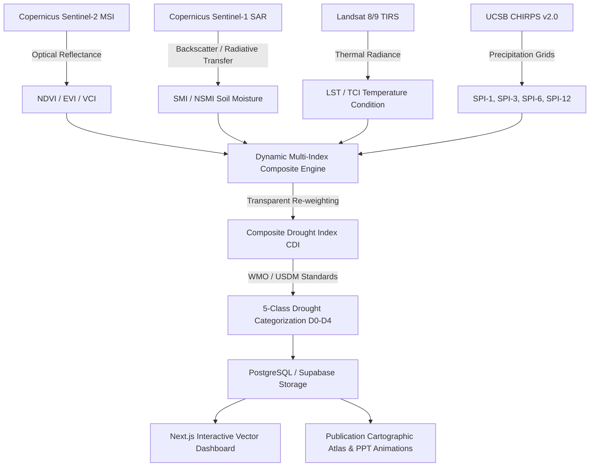

# Near Real-Time Drought Monitoring System — Latur District, Marathwada

<div align="center">
  <p><em>An Advanced Empirical Remote Sensing and Machine-Readable Cartographic Intelligence Platform</em></p>
  <p><strong>Department of Geoinformatics, Shivaji University, Kolhapur</strong></p>
</div>

---

## 1. Executive Summary

The **Latur District Near Real-Time Drought Monitoring System** is an open-source, operational scientific platform developed to provide continuous, high-resolution drought surveillance across **954 villages** and **10 tehsils** in the drought-vulnerable Marathwada region of Maharashtra, India. 

Integrating multi-sensor Earth Observation constellations—including **Copernicus Sentinel-2 MSI** (optical vegetation condition), **Sentinel-1 C-SAR** (root-zone soil moisture), **Landsat 8/9 TIRS** (land surface temperature), and **UCSB CHIRPS** (satellite-gauge precipitation)—the system computes standardized multi-scale hydrological indicators and fuses them into a transparent, rule-grounded **Composite Drought Index (CDI)**.


<div class="figure-caption">Flagship Animation: 130-Month monthly cadastral drought evolution across 954 villages in Latur District (2016–2026). Click image to inspect in full-screen lightbox.</div>



---

## 2. Decadal Drought Dynamics (2016–2026)

Over the 11-year empirical record (124,020 observed village-months), Latur has undergone severe hydrometeorological oscillations:


<div class="figure-caption">Figure 1.1: Monthly Drought Affected Percentage (DAP) stacked distribution from 2016 to 2026 across 954 villages. Shows the devastating 2018–2019 crisis (>80% D2–D4), the 2020–2022 wet recovery, and emerging 2026 localized stress.</div>

---

## 3. Institutional Attribution & Research Team

This research and operational monitoring suite was conceptualized, developed, and validated at Shivaji University:

- **Institution:** Department of Geoinformatics / Department of Geography, Shivaji University, Kolhapur, Maharashtra, India.
- **Academic Research Guide:** **Dr. Sachin S. Panhalkar**, Professor and Head of Department.
- **Lead Research Team:**
    - **Rajnandini U. Kadam** (Project Lead, `rajnandinikadam221@gmail.com`)
    - **Aishwarya B. Jagtap**
    - **Pavan S. Devkar**
    - **Shital B. Gurav**
    - **Trupti U. Jadhav**

---

## 4. Geographic Context: Latur District & The Marathwada Crisis

Latur district spans an area of approximately **7,157 km²** in the south-eastern sector of Maharashtra's Marathwada division, situated on the Balaghat plateau between latitudes $17^\circ 52'\text{N}$ to $18^\circ 50'\text{N}$ and longitudes $76^\circ 18'\text{E}$ to $77^\circ 28'\text{E}$. 

```
                                  LATUR DISTRICT (10 TEHSILS)
                  
                  [ Renapur ]             [ Ahmadpur ]       [ Jalkot ]
                       \                      |                  /
             [ Latur ]  ---  [ Chakur ]  ---  [ Shirur-Anantpal ]
                 |               |                 |
             [ Ausa ]   ---  [ Deoni ]   ---   [ Udgir ]
                 \                                 /
                            [ Nilanga ]
```

### Why Latur Demands Continuous Village-Level Surveillance
1. **Rain-Shadow Semiarid Climatology:** Latur lies on the leeward side of the Western Ghats, receiving an erratic mean annual rainfall of **750–800 mm**, with $>85\%$ concentrated during the southwest monsoon (June–September).
2. **Heavy Vertisol Soils (Black Cotton Soils):** Agriculture predominantly relies on rainfed deep vertisols. While these soils exhibit high moisture retention capacity, prolonged dry spells during the Kharif flowering phase (August–September) cause rapid moisture depletion, soil cracking, and root shearing.
3. **Historical Drought Emergencies:** In 2015–2016, Latur suffered one of India's most catastrophic municipal water crises, requiring the deployment of the *Jaldoot* water trains to deliver drinking water to Latur city. Subsequent agricultural crises in 2018–2019 devastated Kharif soybean and pulse yields.
4. **Administrative Granularity:** The district is partitioned into **10 administrative tehsils** encompassing **954 revenue villages**. Broad tehsil-averaged rainfall statistics frequently conceal acute micro-watershed crop failures. This system delivers village-level resolution ($10\text{--}20\text{ m}$ effective spatial scale).

---

## 5. Key Scientific Achievements & Rigor

| Empirical Dimension | Project Specification | Scientific Significance |
| :--- | :--- | :--- |
| **Spatial Scale** | **954 Villages**, 10 Tehsils | Sub-watershed micro-regional granularity |
| **Temporal Record** | **2016–2026** (130 Continuous Months) | Decadal baseline spanning extreme droughts and wet La Niña cycles |
| **Observation Volume** | **124,020 Village-Months** | $99.2\%$ empirical completeness across the full record |
| **Composite Architecture** | Multi-Component Weighted Composite | Fully transparent; zero black-box / uninterpretable ML models |
| **Sensor Harmonization** | S2 MSI + S1 SAR + Landsat TIRS + CHIRPS | Cross-calibrated multi-sensor coverage |
| **Cartographic Standard** | Times New Roman, Georeferenced Scale, Single North Arrow | Conforms strictly to peer-reviewed remote sensing journal standards |
| **Operational Delivery** | Next.js + Leaflet + Supabase + MkDocs | Automated weekly ingestion and public open-access dissemination |

---

<div class="chapter-nav-card">
  <span></span>
  <a class="next-link" href="science/literature/">Start Reading: Literature Review & Foundations →</a>
</div>
