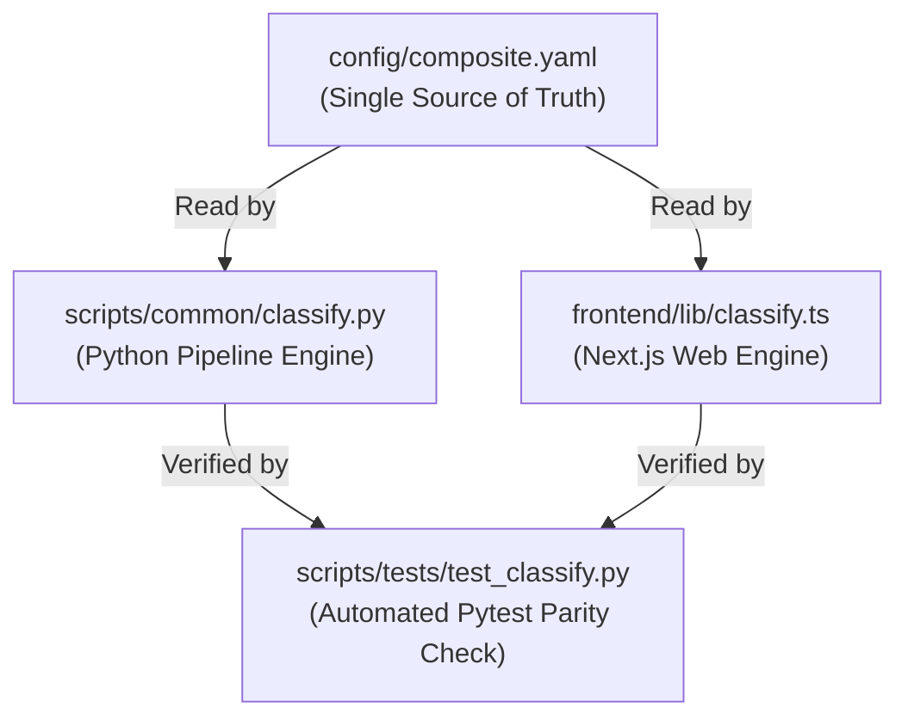

# Drought Severity Classification & Tri-Stack Parity

This document outlines the 5-tier drought severity classification and the cross-stack parity enforcement between Python, TypeScript, and YAML.

---

## 1. 5-Tier USDM / WMO Severity Scale

The platform classifies agricultural and hydrological drought into 5 standard categories following U.S. Drought Monitor (USDM) and World Meteorological Organization (WMO) conventions:

```
+---------------------------------------------------------------------------------------------------------+
|                                      DROUGHT SEVERITY CLASSIFICATION                                    |
+-------+-----------------------+------------------+-----------+---------------------+--------------------+
| Code  | Severity Category     | Color Code       | Hex Color | CDI Score Range     | Typical Return     |
+-------+-----------------------+------------------+-----------+---------------------+--------------------+
| None  | Normal / Wet          | Forest Green     | `#2ca02c` | CDI < 0.15          | Continuous normal  |
| **D0**| Abnormally Dry        | Yellow           | `#ffff00` | 0.15 <= CDI < 0.25  | 3 to 5 years       |
| **D1**| Moderate Drought      | Peach / Tan      | `#fcd37f` | 0.25 <= CDI < 0.35  | 5 to 10 years      |
| **D2**| Severe Drought        | Dark Orange      | `#ffaa00` | 0.35 <= CDI < 0.50  | 10 to 20 years     |
| **D3**| Extreme Drought       | Crimson Red      | `#e60000` | 0.50 <= CDI < 0.70  | 20 to 50 years     |
| **D4**| Exceptional Drought   | Dark Maroon      | `#730000` | CDI >= 0.70         | > 50 years         |
+-------+-----------------------+------------------+-----------+---------------------+--------------------+
```

---

## 2. Tri-Stack Parity Requirement

In distributed remote sensing web architectures, a common source of discrepancy occurs when backend Python processing scripts use different threshold boundaries or color palettes than the frontend TypeScript visualization engine.

To ensure 100% mathematical integrity:



### 2.1 The Single Source of Truth (`config/composite.yaml`)
All threshold values, class labels, and color codes originate from `config/composite.yaml`. Neither Python nor TypeScript may define independent threshold tables.

### 2.2 Automated Parity Verification
The repository test suite includes an automated test (`scripts/tests/test_classify.py`) that executes before every deployment:
- Parses `config/composite.yaml`.
- Inspects `scripts/common/classify.py`.
- Inspects `frontend/lib/classify.ts` and `frontend/lib/metrics.ts`.
- Verifies that all classification boundaries, class names, and hex codes match to $10^{-6}$ precision. If any discrepancy exists, the test suite immediately fails and blocks CI/CD deployment.

